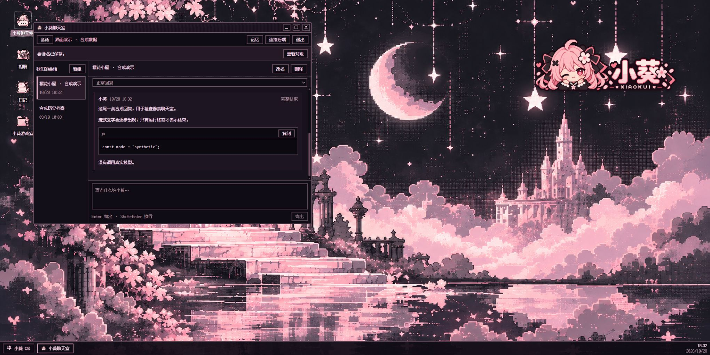

# KuiNest · 葵栖

[简体中文](README.md) | **English**

**A place for conversations to stay.**

KuiNest pairs a cherry blossom pixel desktop with a self-hosted conversation backend. Sessions, character documents, model protocol archives, and confirmed long-term memories live in your own backend, while the interface remains replaceable.


The UI includes a window manager, taskbar, streaming chat, session creation and switching, rename and confirmed deletion, memory review, and a small pixel running game. The backend provides SQLite persistence, authenticated APIs, leased writes, resumable SSE, immutable character versions, context budgeting, and verified backup restoration.

## Quick preview

Use Node.js **24.20.0 / 24.x** and npm **11.19.0**:

```sh
npm ci
npm run build
npm run frontend:dev
```

Open the [local synthetic demo](http://127.0.0.1:5488/?mode=demo) and double-click the chat or game-room icon. Demo mode is explicitly labeled as synthetic and makes no model requests. Assets and fonts are hosted locally. The locked native dependencies provide platform prebuilds; see the getting-started guide for platform issues.



## Your own deployment

Start with the [Chinese getting-started guide](docs/getting-started.md), then the [deployment guide](docs/deployment.md). These detailed guides and most source comments are currently in Chinese.

The examples are newly written synthetic documents. No real character prompts, memories, conversations, accounts, API keys, OAuth grants, device packets, order state, or runtime database are distributed. A fresh runtime starts without a usable login and requires separate account setup and explicit activation. Real model access uses your own provider credentials and same-origin HTTPS.

DeepSeek and MiMo protocol adapters are included. Optional image, search, scheduler, device-context, and MCP modules depend on actual configuration; their presence does not mean they are enabled by default. The gallery and diary are placeholders. Arbitrary shell execution, development-agent tasks, generated-file delivery, message regeneration, and editing individual historical messages are not implemented.

Session deletion hides the session and blocks its public history, runs, events and images. It uses a persistent tombstone and is not secure erasure of private archives or backups. There is no UI restore action. **Previously confirmed independent memories remain available.** Sessions with accepted or running work cannot be deleted until that work ends or is canceled.

## Development

```sh
npm run check:public
npm run build
npm run frontend:check
npm run frontend:build
npm test
```

Tests use synthetic accounts, temporary databases, and injected providers. They do not require API keys or submit real transactions. CI runs the public-source checks, builds, backend tests and frontend tests on Ubuntu. The public runtime initializer has dedicated tests; successful CI does not claim real-provider or device acceptance on another deployment.

See the [architecture](docs/architecture.md), [API](docs/api-contract.md), and [security boundaries](SECURITY.md). The regular server does not depend on an OpenClaw installation; the [migration tools](tools/import-openclaw/README.md) run separately.

Related standalone projects: [McDonald's MCP](https://github.com/AriaEternity/xiaokui-mcd-mcp), [Luckin MCP](https://github.com/AriaEternity/xiaokui-luckin-mcp), and [boot animation](https://github.com/AriaEternity/xiaokui-codex-boot). Included integration source does not automatically enable commerce or provide official credentials.

Project-owned code, documentation and artwork use the [MIT license](LICENSE). Bundled Fusion Pixel fonts retain SIL OFL 1.1; dependencies retain their own licenses. See [third-party notices](THIRD-PARTY-NOTICES.md) and [contributing](CONTRIBUTING.md).
