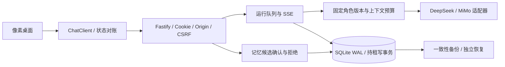

# 架构与资料边界

前端只消费contracts公开DTO与chat-client。浏览器拿不到模型Key、角色原文件、数据库或完整后台reasoning/tool协议。后台协议档案与公开文字投影分别保存，不能把前端历史覆盖为协议记录。

服务由唯一有效SQLite租约保护；迁移检查、领租与业务写入采用事务，失租关闭服务。消息使用clientMessageId受理与查询；丢响应时查询原标识，不制造新提交。SSE序号、运行快照和history/changes承担不同恢复用途，不把断线当作生成完成。

角色资料按不可变版本发布，profile、config与documents摘要组成runtime-binding。普通server不访问旧平台文件，迁移器仅负责显式离线处理。公开初始化器创建一套全新空白资料绑定，和导入器独立。

记忆候选有独立状态与修订，确认后进入记忆头；未确认候选不冒充已确认记忆。会话删除在同一持租事务检查生成任务、停用对应调度并写删除标记；所有公开读取和新提交拒绝已删会话。独立记忆和私有档案保持。

可选MCP/OAuth、图片、搜索和调度各自有明确装配与权限。普通网页聊天不会因为集成源码存在就自动启用第三方服务。自托管不自动获得官方API、模型或交易资格。
